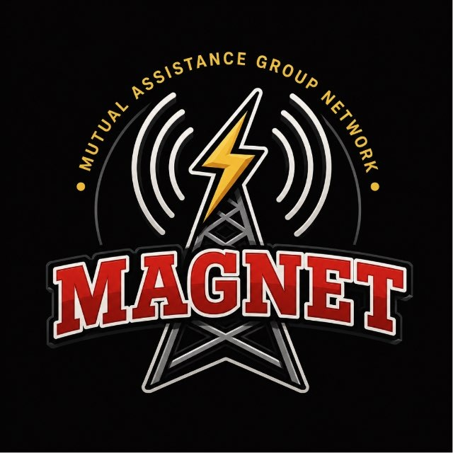

# MagNet HF · Tools & Guides

Software, station setup, operational guidance, and shared resources for MagNet members and the public.

**[Explore Tools & Guides](https://magnet-hf.github.io/)** · **[MagNet website](https://magnethf.com/)** · **[Nets & regions](https://magnethf.com/nets/)**

## Find what you need

| Task | Start here |
| --- | --- |
| Find applications, downloads, and manuals | [Software directory](https://magnet-hf.github.io/software/) |
| Connect software and prepare a station | [Operational guidance](https://magnet-hf.github.io/operational-guidance/) |
| Find or share radio settings | [Radio configurations](https://magnet-hf.github.io/radio-configurations/) |
| Find MagNet forms and supporting files | [Resources](https://magnet-hf.github.io/resources/) |
| Upload a guide or suggest a correction | [Contribute](https://magnet-hf.github.io/contribute/) |

## SpotterX — MagNet Edition

[SpotterX downloads & setup](https://magnet-hf.github.io/software/spotterx/)

A JS8Call companion for mapping, messages, forms, and station awareness. MAGNET-HF is its primary project home. Its hub page tracks the verified download location during the transition from the legacy Mag-Windows repository.

## Software used by MagNet

JS8Call Subspace — MagNet Edition · SpotterX · CommStat · fldigi · flrig · flmsg · flamp · VarAC · Meshtastic · CommsPlan · AMP-Express

The library links to authoritative project sites and records MagNet setup guidance separately. Operating-system choices belong within each tool's instructions.
